**Desarrollo de un prototipo de aplicación móvil de análisis automatizado de URLs extraídos de códigos QR mediante análisis aislado: Backend de análisis avanzado de URLs mediante scoring heurístico, sandboxing dinámico y browser isolation en infraestructura cloud**

Trabajo de graduación · Universidad del Valle de Guatemala (UVG)

> Prototipo de verificación previa al acceso que analiza la URL contenida en un código QR **antes** de que el usuario la abra, como defensa contra el *quishing* (phishing mediante códigos QR).

## Contenido

- [Descripción del proyecto](#descripción-del-proyecto)
- [Tecnologías utilizadas](#tecnologías-utilizadas)
- [Estructura del repositorio](#estructura-del-repositorio)
- [Requisitos previos](#requisitos-previos)
- [Instalación y despliegue en AWS](#instalación-y-despliegue-en-aws)
- [Ejecución](#ejecución)
- [Capturas de pantalla](#capturas-de-pantalla)
- [Video demo](#video-demo)
- [Documentación](#documentación)
- [Autor](#autor)

---

## Descripción del proyecto

Los códigos QR ocultan la dirección de destino hasta el momento del escaneo, lo que facilita ataques de *phishing* conocidos como *quishing*. QRisk es un prototipo de aplicación móvil que verifica la URL de un código QR antes de que el usuario acceda a ella. Este repositorio contiene el **módulo backend**; el frontend móvil (React Native y filtro F1) fue desarrollado en paralelo por María José Villafuerte y se documenta en su propio informe.

El backend expone una API REST que ejecuta una **cascada de filtros con corte anticipado**: cada etapa se ejecuta solo si la anterior no produjo un resultado concluyente.

| Filtro         | Función                                                                                                                                                              |
| -------------- | --------------------------------------------------------------------------------------------------------------------------------------------------------------------- |
| **F1**   | Listas blancas y negras. Se ejecuta en el teléfono; el backend recibe su veredicto como `resultadoF1`.                                                             |
| **F2.1** | Análisis heurístico: puntaje según 14 criterios léxicos, de host y de antigüedad de dominio (WHOIS). Un puntaje mayor a 60 clasifica la URL como `SOSPECHOSO`. |
| **F2.2** | Análisis dinámico en sandbox mediante URLScan.io y VirusTotal, consultados en paralelo con un plazo compartido.                                                     |
| **F2.3** | Vista previa segura: captura remota del sitio, almacenada en un bucket privado de S3 y entregada con una URL firmada de 1 hora.                                       |

Veredictos posibles: `SEGURO`, `MALICIOSO`, `SOSPECHOSO` y `PENDIENTE`.

Funcionalidades adicionales: caché de resultados por URL (7 días, solo para `SOSPECHOSO` y `MALICIOSO`), control de tasa, validación estructural de entradas y un endpoint `/report` para reportar URLs maliciosas.

**Importante:** el sistema se diseñó, desplegó y probó **directamente en AWS (funciones Lambda)**. No se ejecutó ni se probó de forma local.

## Tecnologías utilizadas

| Capa                       | Tecnología                               |
| -------------------------- | ----------------------------------------- |
| Cómputo                   | AWS Lambda (Node.js 20.x, módulos ESM)   |
| Exposición                | Amazon API Gateway REST                   |
| Base de datos relacional   | Amazon RDS (PostgreSQL)                   |
| Caché WHOIS               | Amazon DynamoDB (TTL de 7 días)          |
| Almacenamiento de capturas | Amazon S3 (bucket privado, URLs firmadas) |
| Registros y métricas      | Amazon CloudWatch                         |
| Antigüedad de dominio     | WhoisJSON API                             |
| Sandbox y reputación      | URLScan.io API, VirusTotal API v3         |
| Muestras de evaluación    | PhishTank, OpenPhish, URLhaus, Tranco     |
| Herramientas               | AWS CLI, Git/GitHub, `curl`, pgAdmin    |

## Estructura del repositorio

```
2026-22787-contreras-colindres-fabiola-alejandra
├── src/
│   ├── DB/
│   │   └── base.sql                  # Esquema de la base de datos
│   ├── lambda analisis/              # Función de /analyze
│   │   ├── index.mjs                 # Handler: normalización y cascada
│   │   ├── heuristica.mjs            # F2.1
│   │   ├── sandbox.mjs               # F2.2
│   │   ├── browserIsolation.mjs      # F2.3
│   │   ├── normalizarUrl.mjs
│   │   ├── whois.mjs
│   │   └── package.json
│   ├── lambda reporte/               # Función de /report
│   │   ├── index.mjs
│   │   ├── normalizarUrl.mjs
│   │   └── package.json
│   ├── Testing/                      # Scripts de prueba y medición
│   ├── .env.example                      # Plantilla de variables de entorno
│   └── qrisk-endpoint-doc.md         # Contrato de la API
├── capturas/                         # Capturas de pantalla
├── demo/
│   └── demo.mp4                      # Video demo
├── docs/
│   ├── informe_final.pdf
│   └── consentimiento_firmado.pdf
└── README.md
```

## Requisitos previos

**Cuentas y servicios**

- Cuenta de AWS con acceso a Lambda, API Gateway, RDS, DynamoDB, S3, IAM y CloudWatch (se usó la región `us-east-1`).
- Claves de API gratuitas de:
  - [WhoisJSON](https://whoisjson.com) (1000 solicitudes/mes, 20/min)
  - [URLScan.io](https://urlscan.io) (500 solicitudes/día)
  - [VirusTotal](https://www.virustotal.com) (500 solicitudes/día, 4/min)

**Software en la máquina desde la que se despliega**

- [Node.js 20.x](https://nodejs.org) y `npm`
- [AWS CLI v2](https://docs.aws.amazon.com/cli/latest/userguide/getting-started-install.html), configurado con `aws configure`
- `zip`
- Cliente de PostgreSQL (`psql` o pgAdmin) para cargar el esquema
- `curl` para las pruebas
- Git

## Instalación y despliegue en AWS

El backend **no se ejecuta localmente**: todo el despliegue y las pruebas se realizan sobre AWS. El archivo [`.env.example`](.env.example) es solo una plantilla que lista las variables que deben configurarse en cada función Lambda (consola o CLI); las funciones no leen un archivo `.env`.

Los valores entre `<...>` deben reemplazarse por los propios.

### 1. Clonar el repositorio

```bash
git clone https://github.com/GraduacionesUVG/2026-22787-contreras-colindres-fabiola-alejandra
cd 2026-22787-contreras-colindres-fabiola-alejandra
git checkout dev_backend
```

### 2. Crear el bucket de S3 (capturas)

```bash
aws s3api create-bucket --bucket <nombre-unico-del-bucket> --region us-east-1
aws s3api put-public-access-block --bucket <nombre-unico-del-bucket> \
  --public-access-block-configuration BlockPublicAcls=true,IgnorePublicAcls=true,BlockPublicPolicy=true,RestrictPublicBuckets=true
```

Después, en la consola de S3, crear una **regla de ciclo de vida** que elimine los objetos a los 7 días.

### 3. Crear la tabla de DynamoDB (caché WHOIS)

```bash
aws dynamodb create-table --table-name qrisk-whois-cache \
  --attribute-definitions AttributeName=domain,AttributeType=S \
  --key-schema AttributeName=domain,KeyType=HASH \
  --billing-mode PAY_PER_REQUEST --region us-east-1

aws dynamodb update-time-to-live --table-name qrisk-whois-cache \
  --time-to-live-specification Enabled=true,AttributeName=ttl --region us-east-1
```

### 4. Crear la base de datos PostgreSQL (RDS)

1. En la consola de RDS, crear una instancia PostgreSQL (`qrisk-db`) con una base inicial llamada `enrealidadqr`.
2. Como las funciones Lambda se despliegan **sin VPC** (evita costos de NAT Gateway), la instancia debe ser accesible públicamente y su grupo de seguridad debe permitir conexiones al puerto 5432.
3. Cargar el esquema:

```bash
psql -h <DB_HOST> -U <DB_USER> -d enrealidadqr -f DB/base.sql
```

Se crean las tablas `analisis` y `reportes` con sus índices. Verifique el esquema después de cargarlo.

### 5. Crear el rol de IAM

Crear un rol de ejecución para Lambda con:

- La política administrada `AWSLambdaBasicExecutionRole`.
- Una política en línea que permita `s3:PutObject` y `s3:GetObject` sobre el bucket de capturas, y `dynamodb:PutItem`, `dynamodb:GetItem` y `dynamodb:Query` sobre la tabla `qrisk-whois-cache`.

Anote el ARN del rol (`<ROLE_ARN>`).

### 6. Empaquetar y crear las funciones Lambda

**Función de análisis**

```bash
cd "lambda analisis"
npm ci --omit=dev
zip -r ../analyze.zip .
cd ..

aws lambda create-function --function-name qrisk-analyze \
  --runtime nodejs20.x --handler index.handler \
  --role <ROLE_ARN> --zip-file fileb://analyze.zip \
  --timeout 35 --memory-size 128 --region us-east-1
```

**Función de reportes**

```bash
cd "lambda reporte"
npm ci --omit=dev
zip -r ../report.zip .
cd ..

aws lambda create-function --function-name qrisk-report \
  --runtime nodejs20.x --handler index.handler \
  --role <ROLE_ARN> --zip-file fileb://report.zip \
  --timeout 10 --memory-size 128 --region us-east-1
```

> El *handler* es la función que Lambda ejecuta al recibir una solicitud. `--handler index.handler` significa "la exportación `handler` del archivo `index.mjs`". Por eso `index.mjs` debe contener `export const handler = async (event) => { ... }` (o `export async function handler`).

### 7. Configurar las variables de entorno

Use [`.env.example`](.env.example) como referencia. Configure las variables en cada función (consola de Lambda, sección *Configuration → Environment variables*) o con la CLI:

```bash
aws lambda update-function-configuration --function-name qrisk-analyze --region us-east-1 \
  --environment "Variables={WHOIS_API_KEY=<...>,URLSCAN_API_KEY=<...>,VT_API_KEY=<...>,DB_HOST=<...>,DB_NAME=enrealidadqr,DB_USER=<...>,DB_PASSWORD=<...>,SCREENSHOTS_BUCKET=<nombre-del-bucket>}"
```

> **Cuidado:** `--environment` **reemplaza todas** las variables existentes; envíe siempre el conjunto completo. La función `qrisk-report` solo necesita las variables de conexión a la base de datos (`DB_HOST`, `DB_NAME`, `DB_USER`, `DB_PASSWORD`).

### 8. Crear la API en API Gateway

1. Crear una **API REST** y los recursos `/analyze` y `/report`, cada uno con el método `POST` integrado a su función Lambda (`qrisk-analyze` y `qrisk-report`).
2. Desplegar en una etapa llamada `dev`.
3. En la configuración de la etapa `dev`, establecer la limitación (*throttling*): `rateLimit = 5` y `burstLimit = 10`.
4. **Tiempo límite de integración:** el análisis completo puede tardar más de 29 s. Solicite en *Service Quotas* el aumento del límite de tiempo de integración, edite el `timeoutInMillis` de la integración de `/analyze` (40 000 ms) y **vuelva a desplegar la etapa**. Si omite el redespliegue, se mantiene el límite anterior.
5. La URL de invocación tiene la forma `https://<invoke-url>/dev`. En este proyecto es `https://z0k9lhdru4.execute-api.us-east-1.amazonaws.com/dev`.

### 9. Verificar cuotas de la cuenta

Una cuenta nueva puede tener una cuota de ejecuciones concurrentes de Lambda muy baja (10), lo que provoca respuestas HTTP 500 bajo ráfagas. Si es necesario, solicite el aumento en *Service Quotas*.

### 10. Prueba de humo

```bash
curl -X POST https://<invoke-url>/dev/analyze \
  -H "Content-Type: application/json" \
  -d '{"url": "https://tinyurl.com/2p8x9k3j", "resultadoF1": "INCIERTO"}'
```

Si la respuesta es un JSON con `veredicto_final`, el despliegue es correcto.

## Ejecución

El backend queda activo en AWS y se consume mediante dos endpoints. El contrato completo está en [`src/qrisk-endpoint-doc.md`](Documentación/qrisk-endpoint-doc.md).

### `POST /analyze`

Recibe la URL extraída del QR y el veredicto de F1 (opcional; si se omite se asume `INCIERTO`).

URL base de la API desplegada: `https://z0k9lhdru4.execute-api.us-east-1.amazonaws.com/dev`

```bash
curl -X POST https://z0k9lhdru4.execute-api.us-east-1.amazonaws.com/dev/analyze \
  -H "Content-Type: application/json" \
  -d '{"url": "https://ejemplo.com", "resultadoF1": "INCIERTO"}'
```

Campos principales de la respuesta: `veredicto_final`, `filtro_decisivo`, `score_heuristico`, `criterios_f2_1`, `indicadores_f2_2`, `screenshot_url` y `desde_cache`.

> **Tiempo de espera del cliente:** configure al menos **90–95 s**. Cuando F1 y F2.1 no son concluyentes, el análisis puede tardar hasta unos 35 s en el caso típico, y el backend se corta solo a los ~90 s en el peor caso.

### `POST /report`

Guarda en la base de datos una URL reportada como maliciosa.

```bash
curl -X POST https://z0k9lhdru4.execute-api.us-east-1.amazonaws.com/dev/report \
  -H "Content-Type: application/json" \
  -d '{"url": "https://ejemplo-malicioso.xyz", "motivo": "Formulario pidiendo credenciales"}'
```

### Pruebas y mediciones

La carpeta [`Testing/`](Testing/) contiene los scripts usados para validar el sistema (Node.js 20.x). Se ejecutan **contra el backend desplegado en AWS** (`https://z0k9lhdru4.execute-api.us-east-1.amazonaws.com/dev`), no contra una instancia local:

| Script                    | Propósito                                          |
| ------------------------- | --------------------------------------------------- |
| `test-muestra.mjs`      | Validación de F2.1 (detección y falsos positivos) |
| `medir-cascada.mjs`     | Medición de la cascada completa                    |
| `medir-tiempos-f22.mjs` | Tiempos de respuesta de F2.2                        |
| `probar-validacion.mjs` | Validación de entradas (HTTP 400)                  |
| `prueba-carga.mjs`      | Control de tasa (HTTP 429)                          |

```bash
cd Testing
node <script>.mjs
```

Los registros de ejecución se consultan en Amazon CloudWatch.

### Resultados principales

- La cascada completa generó alerta en 79 de 80 URLs maliciosas (98.8 %).
- Una prueba de integración con 100 URLs publicadas el mismo día produjo 94 alertas.
- La vista previa estuvo disponible en el 89.7 % de los sitios legítimos accesibles evaluados.

Las limitaciones de la evaluación se detallan en el [informe final](docs/informe_final.pdf).

## Capturas de pantalla

Las capturas se encuentran en la carpeta [`capturas/`](capturas/).

|                                                                                              |                                                                                                      |
| -------------------------------------------------------------------------------------------- | ---------------------------------------------------------------------------------------------------- |
| 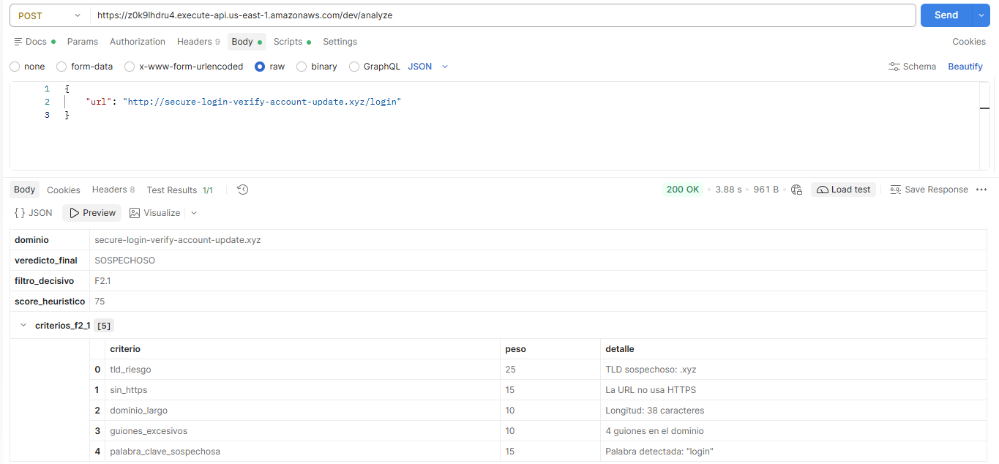**01.** Desglose de criterios de F2.1            | 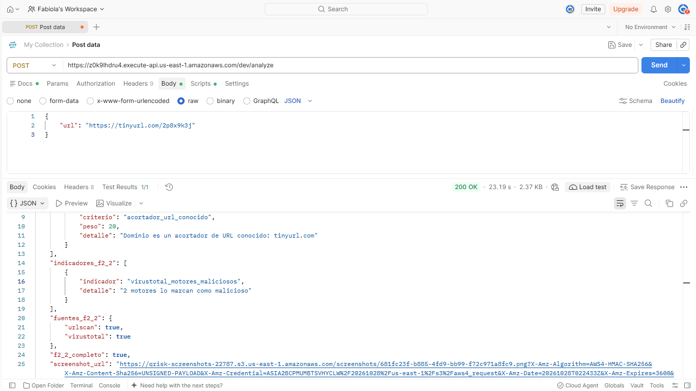**02.** Respuesta de `/analyze` con `screenshot_url` |
| 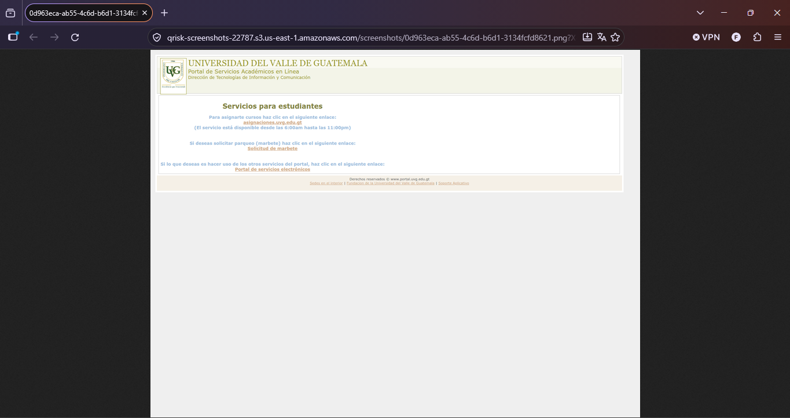**03.** Vista previa obtenida por F2.3           | 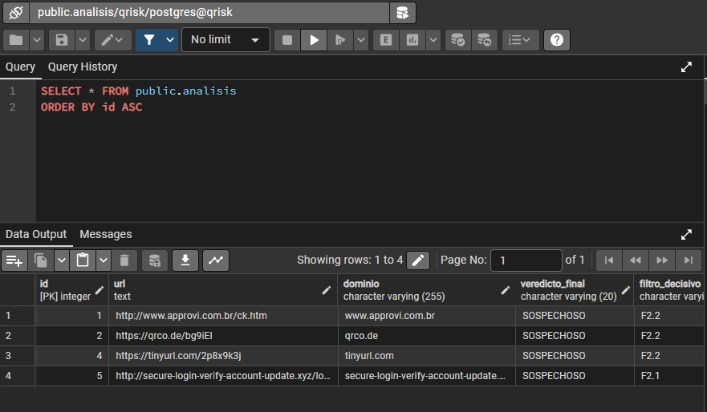**04.** Análisis registrados en PostreSQL              |
| 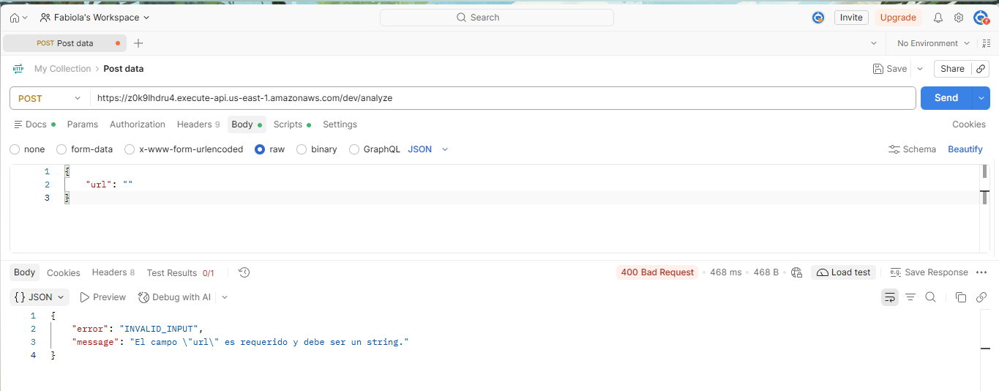**05.** Respuesta HTTP 400 por entrada inválida | 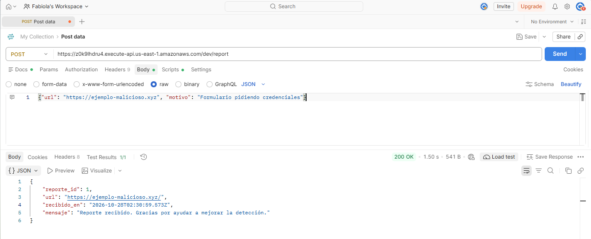**06.** Reporte guardado con `/report`                 |
| 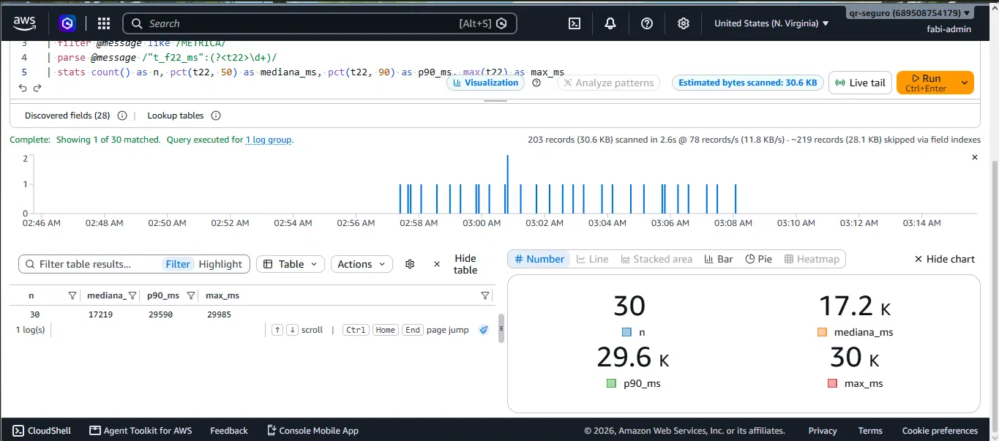**07.** Tiempos de F2.2 en CloudWatch            | 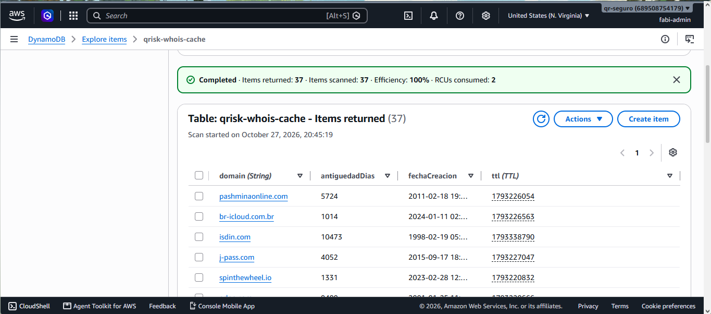**08.** Caché WHOIS almacenado en DynamoDB             |
| 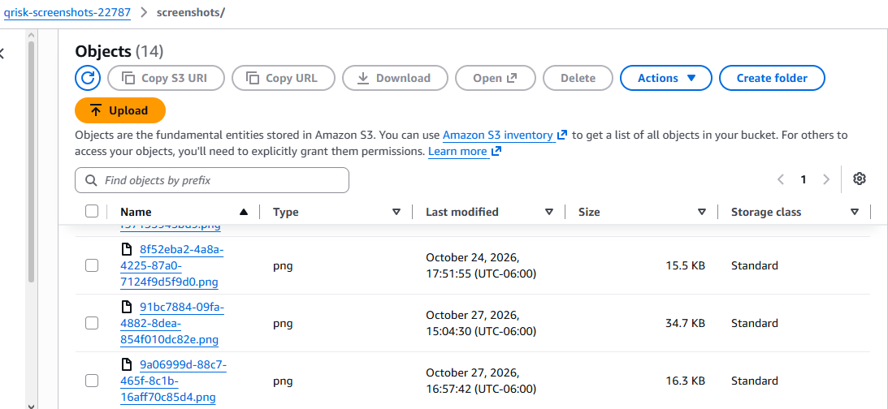**09.** Capturas almacenadas en S3               | 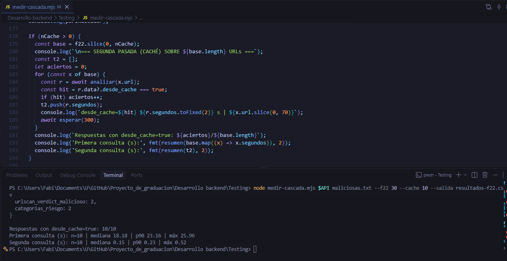**10.** Respuestas con y sin caché                      |
| 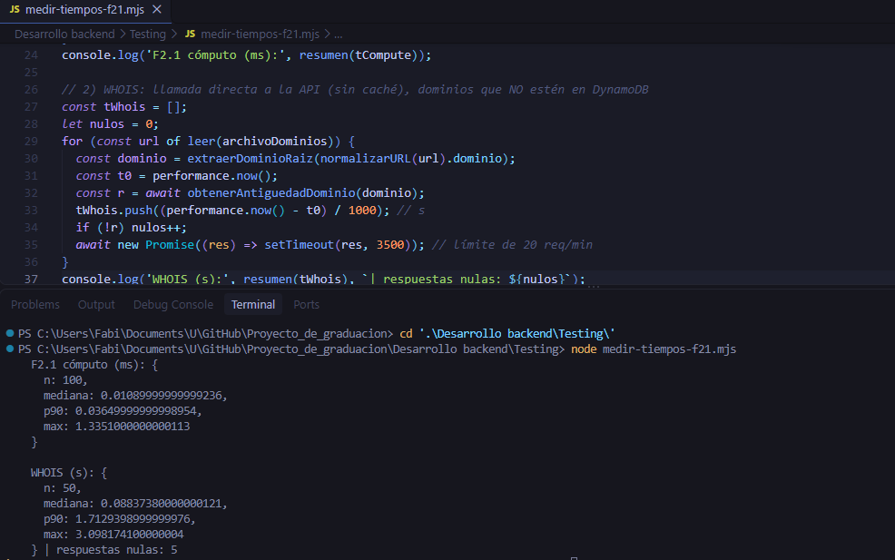**11.** Tiempos de F2.1 y consulta WHOIS         | 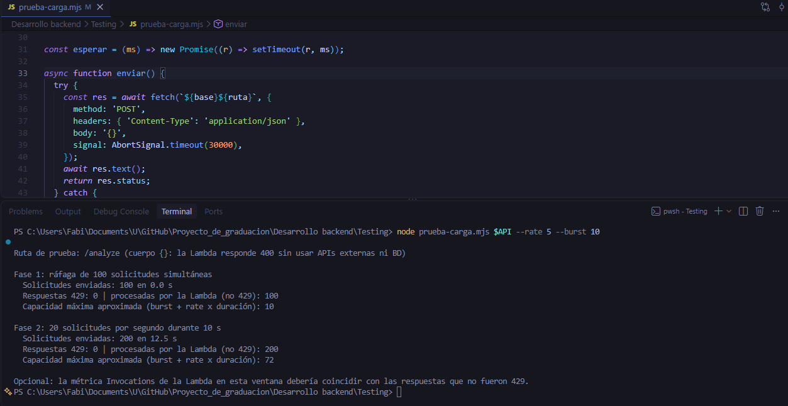**12.** Control de tasa en API Gateway                  |
| 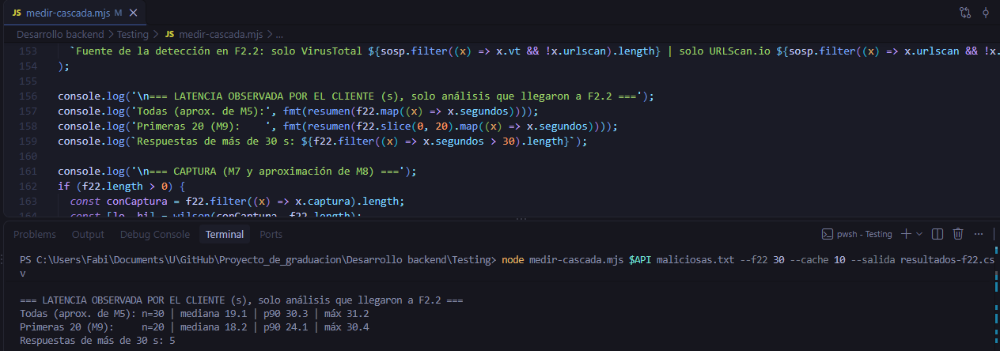**13.** Tiempos de cascada completa              | 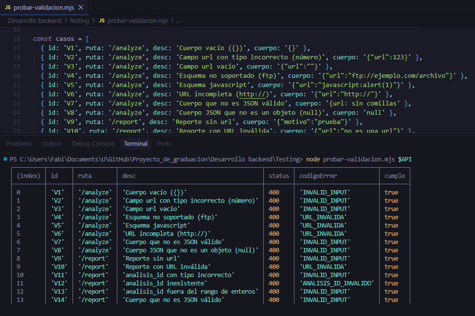**14.** Validación de los 14 casos de entrada          |

## Video demo

El video de demostración está disponible en [`demo/demo.mp4`](demo/demo.mp4).

## Documentación

| Documento                         | Ubicación                                                            |
| --------------------------------- | --------------------------------------------------------------------- |
| Informe final                     | [`docs/informe_final.pdf`](docs/informe_final.pdf)                   |
| Consentimiento firmado            | [`docs/consentimiento_firmado.pdf`](docs/consentimiento_firmado.pdf) |
| Contrato de la API                | [`src/qrisk-endpoint-doc.md`](src/qrisk-endpoint-doc.md)             |
| Plantilla de variables de entorno | [`src/.env.example`](src/.env.example)                               |

## Autor

| Autor             | Carnet | Módulo                                                                                 |
| ----------------- | ------ | --------------------------------------------------------------------------------------- |
| Fabiola Contreras | 22787  | Backend: arquitectura en AWS, filtros F2.1, F2.2 y F2.3, base de datos y almacenamiento |

- **Asesor:** Ing. Juan Carlos Canteo
- **Catedrático del curso:** Ing. Alexander Bolaños
- **Institución:** Universidad del Valle de Guatemala

### Colaboración

El frontend móvil y el filtro F1 fueron desarrollados por María José Villafuerte como parte de un trabajo de graduación complementario. Este repositorio contiene únicamente el módulo backend.
